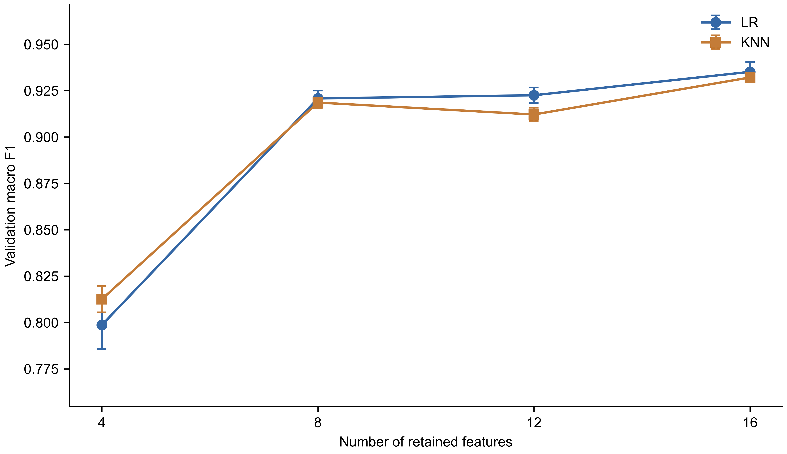

# 机器学习实战：干豆品种分类与特征选择

选题：**干豆品种分类中的特征精简：分类性能、类别差异与选择稳定性分析**。

一个面向初学者的Python机器学习实战小项目：用scikit-learn完成干豆品种分类，比较互信息特征筛选与随机特征对照，并保存模型用于本地CSV预测。普通Windows电脑和CPU即可运行。

主要看两个文件：`train.py`负责训练、评估和绘图，`dry_bean_classification.ipynb`负责加载模型并预测。运行方法、目录说明和图中英文释义统一放在本README。

[运行步骤](#怎么运行) · [项目结构](#目录与源码说明) · [实验规则](#实验规则与结果解释) · [图与英文释义](#所有图中的英文名称与读图方法)

## 实验效果预览

下图比较保留不同特征数量时的验证宏F1，误差条为5折标准差。



以下数字来自已保存的真实测试记录；全部方案在查看测试结果前已确定。

| 方案 | 特征数 | 测试准确率 | 测试宏F1 |
|---|---:|---:|---:|
| 逻辑回归 | 16 | 92.28% | 0.9358 |
| K近邻 | 16 | 92.25% | 0.9352 |
| 随机森林 | 16 | 92.69% | 0.9395 |
| 多数类基线 | 16 | 26.17% | 0.0593 |

这次LR和KNN按预设规则均保留16个特征，尚未找到满足性能要求的精简方案。模型、逐样本预测和评价表均已保存在项目中。


## 怎么运行

用VS Code打开`dry_bean_classification.code-workspace`。本机已经配置好`.venv`，不必重新安装环境。

**第一次训练，或者需要重新训练：**

1. 打开`train.py`，选择项目`.venv`中的Python解释器。
2. 点击右上角“运行Python文件”，在下面的终端看训练进度。
3. 完成后会保存模型、评价表和6张图片。本机这次约1分钟，电脑不同会有差异。

也可以在项目目录的VS Code终端运行：

```powershell
& .\.venv\Scripts\python.exe train.py
```

**使用已经保存的模型预测：**

1. 打开`dry_bean_classification.ipynb`，右上角选择`.venv`内核。
2. 点击“全部运行”，或用Shift+Enter逐格运行。
3. 默认预测本地`data/dry_bean_clean.csv`中的测试数据。预测结果显示在表格里，并保存到`results/local_predictions.csv`。

模型已经实际训练并保存。只做预测时，直接运行Notebook即可；Notebook不会重新训练。最后一格可以查看训练时保存的部分图片。

## 如何看训练输出

下面是这次真实运行的一行（终端还会显示模型名和特征数）：

```text
Fold: 1/5 | Train_acc: 80.0%, Train_loss: 0.579, Val_acc: 80.5%, Val_loss: 0.573, Val_F1: 0.8047
```

| 输出 | 含义 |
|---|---|
| Model / Features | 模型名称 / 输入特征数量；Random表示随机特征对照的子集种子 |
| Fold: 1/5 | 5折验证中的第1折；每折重新训练一个模型 |
| Train_acc / Train_loss | 当前训练折的准确率 / 概率交叉熵损失 |
| Val_acc / Val_loss | 当前验证折的准确率 / 概率交叉熵损失 |
| Val_F1 | 验证折的宏F1，兼顾7个类别，越高越好 |
| Final / Test_* | 方案确定之后的最终测试结果 |

LR是逻辑回归，KNN是K近邻，RF是随机森林，Dummy是始终预测多数类别的基线。准确率越高越好，loss通常越低越好。这里的loss由真实`predict_proba`计算，不含LR的正则惩罚项；预测错误且给真实类别很低概率时，loss会很大。KNN的训练分数包含对训练样本自身的预测，通常偏乐观，应主要看验证分数。

LR、KNN和随机森林没有统一的Epoch过程，因此用真实的Fold进度展示。**5折之间不是连续训练，分数不一定逐行提高，也不绘制伪造的Epoch曲线。** 全部方案确定后才输出Test分数，测试数据不参与选择特征和调整参数。

## 换成自己的本地数据

在Notebook第3步修改`DATA_FILE`，使用`PROJECT_DIRECTORY / "data" / "你的文件.csv"`这样的相对路径即可。

CSV必须包含训练时同名的16个数值特征，列名会在Notebook中显示；列顺序可以不同，程序会自动对齐。`Class`真实类别列可有可无，其他列会被忽略。没有`split`列时预测全部行；有该列且`USE_TEST_ONLY=True`时，只取`split=test`的行。特征不能缺失或含无穷值。

模型文件里已经包含标准化和特征选择，预测时直接使用，不要重新fit。请只加载自己生成或可信来源的joblib模型。

## 目录与源码说明

```text
Dry-Bean-Feature-Selection/
├─ train.py                         训练、验证、测试、绘图、保存模型
├─ dry_bean_classification.ipynb     加载模型、读取本地CSV、预测和展示
├─ data_loader.py                   读取并校验官方ZIP数据
├─ README.md                        统一说明
├─ requirements.txt                 Python依赖
├─ dry_bean_classification.code-workspace  VS Code工作区
├─ data/
│  ├─ dry_bean_dataset.zip          官方原始数据，已包含，可离线训练
│  └─ dry_bean_clean.csv            去重数据、样本ID、数据划分、验证折号
├─ models/
│  └─ bean_classifier.joblib        保存的LR_selected模型及其预处理管线
└─ results/
   ├─ figures/                      6张真实结果PNG图
   ├─ cross_validation_results.csv  每折参数、种子、特征、训练/验证分数
   ├─ model_comparison.csv          LR/KNN各特征数的5折平均分和标准差
   ├─ test_results.csv              6个固定方案的最终测试分数
   ├─ test_predictions.csv          各方案的逐样本真值和预测
   ├─ classification_report.csv     LR_selected的逐类评价
   ├─ feature_selection_frequency.csv  5折特征入选次数
   ├─ experiment_settings.json      最近一次训练的参数、版本和复现命令
   ├─ training_log.txt              逐折进度和每次完整配置
   ├─ validation_predictions.npz    最近一次85次验证的逐样本预测
   └─ local_predictions.csv         Notebook保存的本地预测
```

源码只有三个文件，不需要`run_project.py`。结果统一放在`results`，不生成Notebook副本或新的运行目录。`.venv`是环境，`.vscode`是编辑器设置，不是要阅读的实验源码。

## 实验规则与结果解释

- 原始13,611行、16特征、7类；划分前去除68条重复输入，剩13,543行。
- 固定种子20261025，分层划分10,834条开发数据和2,709条测试数据。
- LR和KNN比较4/8/12/16特征，各做5折，共40次验证拟合；KNN再做3个维数×3个随机子集×5折，共45次对照。
- 参数预先固定：LR的C=1，KNN邻居数=5，RF树数=100。以宏F1为主指标。
- 标准化和MI筛选放在Pipeline中，**每次只在训练折拟合**。测试数据不参与选型。
- 选择规则：相对16特征的验证宏F1，下降不超过0.01时，选择特征最少的方案。
- 最后固定评价LR全特征/筛选方案、KNN全特征/筛选方案、RF和多数类基线6个角色。演示保存的模型预先指定为LR_selected，不按测试结果挑选。

当前LR和KNN都按规则保留16特征，说明本次没有得到满足规则的精简方案。两种角色的特征数相同时，结果相同是正常现象。不能为了出现“提升”反复查看测试集后改规则。

6张图依次表示开发集类别数量、开发集特征相关性、特征数与验证宏F1、MI相对随机特征的同折宏F1差、特征入选频率、LR_selected测试混淆矩阵。误差条是5折标准差，用于描述划分波动，不是独立实验的置信区间。

训练指标CSV和日志追加保存，用`run_id`区分运行；旧实验没有记录过的新loss列留空，不补造。模型、图片、清洗CSV、参数JSON和NPZ更新为最近一次；Notebook预测CSV也只保留最近一次。每次完整配置还写入日志，方便追溯。

交付前已真实完成训练和Notebook全部单元格运行；核对了85次验证的逐样本预测、6个测试方案、保存模型与Notebook预测的一致性，并检查了无标签CSV、列顺序变化和缺少列时的处理。

## 所有图中的英文名称与读图方法

### 6张图分别看什么

| 图片文件 | 中文意思与读图方法 |
|---|---|
| `class_distribution.png` | 类别分布图：每根柱子是一个品种，越高表示开发集中该类样本越多。 |
| `feature_correlation.png` | 特征相关性图：红色偏向正相关，蓝色偏向负相关，颜色接近中间表示线性相关较弱；相关性不等于因果关系。 |
| `feature_count_comparison.png` | 特征数量对比图：比较LR和KNN保留4、8、12、16个特征时的验证宏F1，点越高越好。误差条是5折标准差。 |
| `random_feature_comparison.png` | MI与随机特征的对比图：纵坐标是同折的“MI宏F1－3个随机子集的平均宏F1”。大于0表示MI更好，小于0表示随机子集平均更好；虚线是0，误差条是5折差值的标准差。 |
| `feature_selection_frequency.png` | 特征入选次数热力图：右侧连续色条为0～5次；深蓝色表示5折全选，浅色表示5折均未选。 |
| `confusion_matrix.png` | 混淆矩阵：行是真实类别，列是预测类别，每格是样本个数；对角线是预测正确的数量，其他位置是分错的数量。 |

当前入选次数只有0和5，说明在每个保留特征数下，5折选出的名单一致。颜色少来自真实数据；这不代表特征的重要性都一样，也不保证分类效果更好。

### 坐标轴、图例和模型缩写

| 图中英文 | 中文意思 |
|---|---|
| Bean class | 干豆品种类别。 |
| Development sample count | 开发集中的样本数量。 |
| Pearson correlation | 皮尔逊相关系数，范围为−1到1，衡量两个特征的线性相关程度。 |
| Number of retained features | 保留的特征数量，横轴4、8、12、16表示不同输入特征数。 |
| Validation macro F1 | 验证集宏F1：先算每个类别的F1，再对7类等权平均；越高越好。 |
| Macro F1 difference (MI - random) | 宏F1差值（MI选特征方案减去随机选特征方案）。 |
| Selected folds | 选中该特征的验证折数，即它在5次特征筛选中出现了几次。 |
| True label | 真实类别，对应混淆矩阵的行。 |
| Predicted label | 预测类别，对应混淆矩阵的列。 |
| LR (Logistic Regression) | 逻辑回归分类模型。 |
| KNN (K-Nearest Neighbors) | K近邻分类模型。 |
| MI (Mutual Information) | 互信息，用来衡量单个特征与类别的关联，并据此筛选特征。 |

RF（Random Forest，随机森林）和Dummy（多数类基线）出现在训练输出和结果表中。`full`表示使用全部16个特征，`selected`表示按验证规则选定的方案；`selected`不一定比`full`特征少。

### 16个特征名称

下面按图片和本地CSV中的列名排列。这些数值来自豆粒图像的轮廓和形状测量，并非图片像素直接输入模型。名称含义参考[UCI官方数据说明](https://archive.ics.uci.edu/dataset/602/dry+bean+dataset)。

| 图中名称 / CSV列名 | 中文意思与直观理解 |
|---|---|
| Area | 面积：豆粒轮廓内的像素数量。 |
| Perimeter | 周长：豆粒轮廓边界的长度。 |
| MajorAxisLength | 长轴长度：描述豆粒较长方向的长度。 |
| MinorAxisLength | 短轴长度：描述与长轴垂直方向的宽度。 |
| AspectRation | 长宽比：长轴与短轴的比值，描述豆粒细长程度。原始文件如此拼写，UCI网页写作AspectRatio；使用本项目CSV时保留AspectRation。 |
| Eccentricity | 偏心率：与豆粒区域相匹配的椭圆的偏心程度。 |
| ConvexArea | 凸包面积：能够包住豆粒轮廓的最小凸多边形的像素面积。 |
| EquivDiameter | 等效直径：与豆粒面积相等的圆的直径。 |
| Extent | 外接矩形填充程度：反映豆粒区域在外接矩形中占据的程度。 |
| Solidity | 凸包填充程度：反映豆粒区域对其凸包的填充程度。 |
| roundness | 圆度：由面积和周长计算，公式为`4π×面积/周长²`。 |
| Compactness | 紧致度：本数据集中为“等效直径/长轴长度”，用于描述形状。 |
| ShapeFactor1 | 形状因子1：原数据定义的第1个形状指标。 |
| ShapeFactor2 | 形状因子2：原数据定义的第2个形状指标。 |
| ShapeFactor3 | 形状因子3：原数据定义的第3个形状指标。 |
| ShapeFactor4 | 形状因子4：原数据定义的第4个形状指标。 |

ShapeFactor的1～4只是指标编号，不是重要性排名；UCI页面没有展开这4项的公式，这里不凭名称猜测。

### 7个类别名称

下面是原始数据中的干豆品种标签，并不是7个通用豆类的英文名称。保留原名，可以和CSV及预测结果直接对应。

| 图中标签 | 含义 |
|---|---|
| BARBUNYA | Barbunya品种。 |
| BOMBAY | Bombay品种。 |
| CALI | Cali品种。 |
| DERMASON | Dermason品种，按本地数据的实际标签拼写。 |
| HOROZ | Horoz品种。 |
| SEKER | Seker品种。 |
| SIRA | Sira品种。 |

## 数据与环境

数据来自[UCI Dry Bean](https://archive.ics.uci.edu/dataset/602/dry+bean+dataset)，[数据DOI](https://doi.org/10.24432/C50S4B)，许可CC BY 4.0。读取时检查原始ZIP的SHA-256。

其他电脑先安装Python 3.12及VS Code的Python/Jupyter扩展。从GitHub下载ZIP并解压，或使用下面的命令获取项目，再创建运行环境：

```powershell
git clone https://github.com/cosin17/Dry-Bean-Feature-Selection.git
cd Dry-Bean-Feature-Selection
py -3.12 -m venv .venv
& .\.venv\Scripts\python.exe -m pip install -r requirements.txt
```

然后选择新的`.venv`解释器和Notebook内核。移动项目时保持相对目录，并在新位置重建环境。

## 中文实战项目参考

参考以下仓库的中文讲解、算法入口和实战展示方式，保持本项目的源码和目录精简。关注度为2026年10月25日访问GitHub页面时的约数，之后会变化。

| 参考项目 | 当时Star数 | 本项目借鉴的组织方式 |
|---|---:|---|
| [ApacheCN AiLearning](https://github.com/apachecn/AiLearning) | 约4.26万 | 中文入门说明与清晰的学习入口。 |
| [Jack-Cherish / Machine-Learning](https://github.com/Jack-Cherish/Machine-Learning) | 约1.04万 | 按算法和实例解释代码，便于初学者阅读。 |
| [Datawhale / machine-learning-toy-code](https://github.com/datawhalechina/machine-learning-toy-code) | 约1000 | 把scikit-learn算法与具体实战联系起来。 |

项目适合练习分类、交叉验证、特征筛选、结果读图和模型保存。如果复现时遇到问题，可以在本仓库的Issues中附上运行命令和报错内容。
